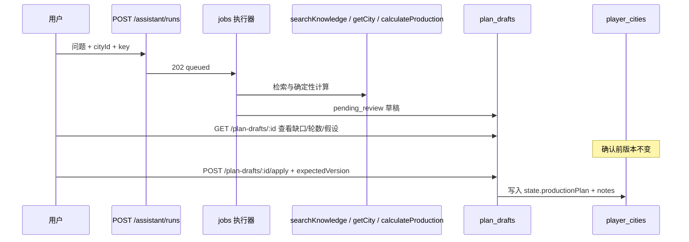

# 助手规划工作流（检索 → 计算 → 草稿 → 确认写档）

助手在后端通过受控工具完成问答：**不直接写数据库**。规划类问题会生成 **计划草稿**；只有用户确认后才写入城市存档（乐观锁 `expectedVersion`）。

## 流程



## 发起规划

1. 登录并选择城市存档（Web 助手页或 API 传 `cityId`）。
2. 使用明确语法，例如：**应天府农田普通档粮食到30，每天上线4次**（须含资源、单一目标总量、上线次数；多配方时需写建筑与档位）。
3. 创建任务：

```bash
curl -b cookie.txt -H 'Content-Type: application/json' -H 'Origin: http://127.0.0.1:5173' \
  -d '{"question":"应天府农田普通档粮食到30，每天上线4次","cityId":"<city-uuid>","key":"plan-1"}' \
  http://127.0.0.1:3100/api/v1/assistant/runs
```

4. 轮询 `GET /api/v1/jobs/:id`，成功时 `result` 含 `{ answer, planDraftId }`。
5. `GET /api/v1/plan-drafts/:planDraftId` 查看草稿（缺口 `inventoryDiff`、轮数、阻塞项、引用）。

**模型未配置**时仍返回检索与确定性计算；`answer.assumptions` 会说明仅资料/计算。

## 确认应用

```bash
curl -b cookie.txt -X POST -H 'Content-Type: application/json' -H 'Origin: http://127.0.0.1:5173' \
  -d '{"expectedVersion":1}' \
  http://127.0.0.1:3100/api/v1/plan-drafts/<draft-id>/apply
```

- 仅当草稿内 `production.status === ok`（**已审核配方**且参数完整）才写入。
- 版本冲突返回 **409**；计算未通过返回 **422**。
- 写入内容：`state.productionPlan`（目标、轮数、缺口等）与 `notes` 摘要；**不自动修改库存数量**。

Web：助手页在任务完成后展示「计划草稿」，点击 **确认应用到存档**。

## 边界

- 助手工具见 `apps/api/src/modules/ai/tools.ts`；无 shell、任意 URL、写 SQL。
- 未审核配方不会进入 `eligibleRecipes`，精确规划为 `need_more_data`，草稿不可 apply。
- 取消进行中的 assistant job 会删除关联的 `pending_review` 计划草稿（与截图草稿一致）。

## 验证

```bash
npm run db:migrate   # 含 007_plan_drafts.sql
npm test -- tests/assistant-plan-workflow.test.ts tests/assistant-grounding.test.ts
```

## 依赖说明

- 精确生产规划依赖 **已发布知识 + 人工审核配方**（见 `docs/acceptance.md`）；本 PR 基于 `main`，不依赖 Wiki bundle PR #1；审核 CLI（PR #2）为运维便利，测试中可直接插入 `reviewed` 配方。
